# Harsh Meena

### Aspiring Data Analyst | BI Analyst

I build practical analytics projects with SQL, Python, Power BI, and Excel. My analytics repositories are independent practice work using public, benchmark, or synthetic datasets; they are not client engagements.

[LinkedIn](https://www.linkedin.com/in/harsh-meena-analyst) ·
[Email](mailto:harshmeena9977@gmail.com) ·
[Portfolio](https://harshmeena9977-ops.github.io/)

  

  
  

---

## Current focus

I’m preparing an end-to-end analytics project around a current business workflow. The project brief, data provenance, analysis, dashboard, and evaluation will be published after they are ready to review.

## Practice projects

### BI and dashboards

- [Workforce Attrition & Retention Analytics](https://github.com/harshmeena9977-ops/workforce-attrition-retention-analytics) — Power BI practice project using a public HR benchmark dataset.
- [Global Superstore Sales Analysis](https://github.com/harshmeena9977-ops/Global-Superstore-Sales-Analysis) — retail SQL/Python/Power BI practice; documented results are still being reconciled.
- [Superstore Power BI Dashboard](https://github.com/harshmeena9977-ops/Superstore-Analytics-Power-BI-Dashboard) — Power BI report practice.
- [Personal Finance Dashboard](https://github.com/harshmeena9977-ops/Personal-Finance-Dashboard) — Excel budget and expense tracking practice.
- [Supply Chain Dashboard](https://github.com/harshmeena9977-ops/Samsung-Supply-Chain-Analytics-Dashboard) — independent dashboard exercise; not affiliated with Samsung.

### Python, statistics, and interactive analysis

- [Hospital Patient Segmentation](https://github.com/harshmeena9977-ops/hospital-patient-segmentation-analytics) — Yuvaintern internship task project; no certificate is claimed.
- [S&P 500 Streamlit Dashboard](https://github.com/harshmeena9977-ops/sp500-financial-analytics) — interactive dashboard over historical 2014–2017 market data; not a real-time market feed or AI agent.
- [Hypothesis Testing: Discount Impact](https://github.com/harshmeena9977-ops/Hypothesis-Testing-Discount-Impact) — small paired-test practice project.
- [Yelp Restaurant Metrics](https://github.com/harshmeena9977-ops/yelp-restaurant-success-metrics) — public-dataset analysis practice.

## Supporting projects

- [MediConnect Pro](https://github.com/harshmeena9977-ops/mediconnect-pro) — Django REST API side project.

## Tools shown in my repositories

**Analytics:** SQL, SQLite, Python, pandas, scikit-learn, Excel  
**BI and apps:** Power BI, DAX, Power Query, Streamlit, Plotly  
**Backend side project:** Django REST Framework

## Contact

- Email: [harshmeena9977@gmail.com](mailto:harshmeena9977@gmail.com)
- LinkedIn: [harsh-meena-analyst](https://www.linkedin.com/in/harsh-meena-analyst)
- Portfolio: [harshmeena9977-ops.github.io](https://harshmeena9977-ops.github.io/)
